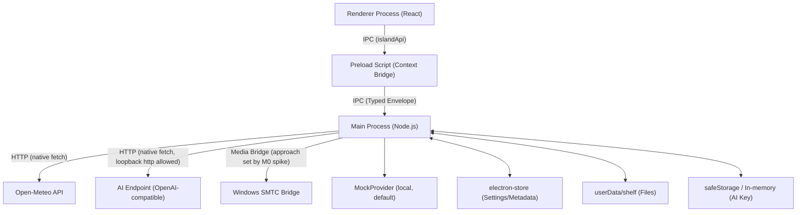

# Architecture

## 1. System Overview
Emoji Island is a local-first Electron application structured into three primary components: the Main Process (Node.js), the Preload Script (Context Bridge), and the Renderer Process (React). It strictly enforces `contextIsolation: true` and `sandbox: true`.

## 2. Security & Boundaries
This application adheres to a strict security model (per DECISIONS.md D-012, D-013, D-014).
*   **Electron Configuration:** `contextIsolation: true`, `nodeIntegration: false`, `sandbox: true`. Navigation and new windows are blocked. No remote code execution.
*   **Preload API (`islandApi`):** Frozen and strongly typed. It exposes one specific method per allowed IPC channel. It MUST NOT expose `ipcRenderer`, `require`, `process`, or generic `send`/`invoke`.
*   **IPC Validation:** Every IPC payload is validated in the Main Process using `zod`.
*   **Content Security Policy (CSP):** `default-src 'self'; script-src 'self'; style-src 'self' 'unsafe-inline'; img-src 'self' data:; font-src 'self'; connect-src 'none'; object-src 'none'; base-uri 'none'; form-action 'none'`. All network requests are proxied through the Main Process.
*   **File Drop & Sanitization:** The Renderer relies on `webUtils.getPathForFile(file)`. The Main Process receives the path, validates it via `lstat` + `realpath`, rejects unsafe targets (symlinks, directories, devices, non-local), enforces caps, stream-copies to a temporary file in `userData/shelf`, and renames atomically. Filenames are strictly sanitized (D-012).
*   **Secrets Management:** AI API keys are stored exclusively in the Main Process via `safeStorage`. If `isEncryptionAvailable()` returns false, the key is held in memory for the session only. The key is never logged or sent to the Renderer.
*   **AI Output:** All AI output is treated as untrusted plain text and rendered without HTML parsing.

## 3. UI & Window Management
*   **Overlay Window:** A single `BrowserWindow` instantiated as frameless, transparent, `skipTaskbar: true`, `resizable: false`, and `hasShadow: false`. Positioned top-center on the primary display.
*   **Always-on-Top:** Enforced via `win.setAlwaysOnTop(true, 'screen-saver')`. Exclusive-fullscreen applications may still cover the overlay.
*   **Expansion & Collapse:** Handled by resizing the single window bounds (`setContentSize`).
    *   Collapsed: `280x40` px. Non-focusable.
    *   Expanded: `420x360` px (max height 420 px). Focusable.
*   **Focus Model & Blur:** On window blur, start a 300 ms collapse timer ONLY if the renderer last reported `window:setInputActive { active: false }`. If active=true, do not start the timer. Cancel a running timer on refocus or when active becomes true.
*   **DPI Scaling:** Sizes are fixed in CSS pixels (100% scale). The application relies on Chromium's native DIP scaling for 125%/150%.
*   **Glass Theme:** Semi-opaque rgba background + 1 px border. Does not rely on OS-level blur effects.

## 4. Feature Modules
*   **Clock & Weather:** Main Process polls Open-Meteo on a 30-minute cache loop. Serves data to Renderer. Handles "stale" (up to 24h) and "offline" states natively.
*   **Media (SMTC Bridge):** Main Process interfaces with Windows SMTC (approach depends on Spike M0). Polls every 3s only while a session exists. Pushes `media:stateChanged` events to the Renderer.
*   **File Shelf:** Main Process manages copy, metadata, and deletion within `userData/shelf`. `shelf:getPreview` generates a data URL on demand (PNG/JPEG/WebP/GIF, <= 2 MB) and never persists it.
*   **AI Chat:** Main Process wraps the MockProvider and the single OpenAI-compatible adapter. Handles the 8-message context window, timeouts (15s), and HTTP rules (D-007).

## 5. Error Handling & Logging
*   **IPC Envelope:** All responses follow a strict envelope: `{ ok: boolean, data: T | null, error: { code, message } | null }`. Unhandled rejections are caught at the IPC boundary and returned as `UNKNOWN_ERROR`.
*   **Logging:** Uses `electron-log` configured for max 3 files x 5 MB. API keys and endpoint tokens are strictly redacted before logging.
*   **Environment Variables:** Driven by `.env.example`. Includes `EMOJI_ISLAND_LOG_LEVEL`. No secret values are ever committed.

## 6. App Lifecycle
*   **Single instance:** `app.requestSingleInstanceLock()`; a second launch shows the island via the `second-instance` event.
*   **Global hotkey:** registered in main via `globalShortcut` (default Ctrl+Alt+Space). On failure, show a notice and fall back to tray toggle; never crash.
*   **Tray:** menu with Show/Hide and Quit. Quit unregisters shortcuts.

## 7. Folder Structure
*   `src/main/`        (window, ipc handlers, services: weather, media, shelf, ai, store, logger)
*   `src/preload/`     (islandApi via contextBridge)
*   `src/renderer/`    (React: components, hooks, styles)
*   `src/shared/`      (types.ts, zod schemas, constants)
*   `docs/`            (spec documents)

## 8. Build, CI, Dependencies
*   Packaging: `electron-builder` (NSIS + portable ZIP per D-019). CI: GitHub Actions, test/lint/build on pull request, release on `v*` tag.
*   Dependencies: exactly the allowlist in D-003. No HTTP library; use native `fetch`.