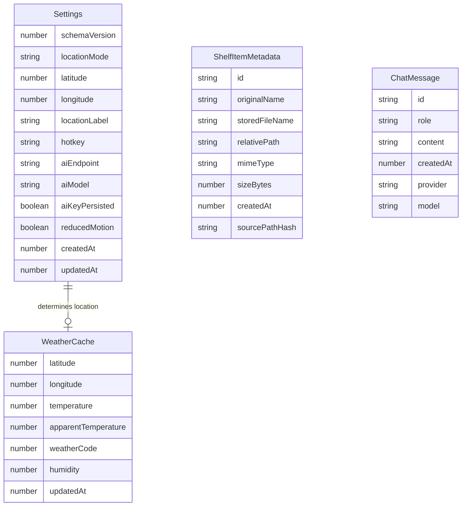

# Data Model

This document defines the storage schemas and data structures used within the application. No relational database is used. Configuration and metadata are stored in JSON via `electron-store`, while physical files are stored in `userData/shelf`.

## 1. Entity Relationship

*Note: Entities are independent collections; there are no relational links.*

## 2. Schemas & Constraints

All types are exported in `src/shared/types.ts` and validated in the Main Process using `zod`.

### Settings (Stored in `electron-store`)
*   **schemaVersion:** `number` (Default: `1`) - Used for future migrations.
*   **locationMode:** `enum('preset', 'manual')` (Default: `'preset'`)
*   **latitude:** `number` (Range: `-90` to `90`. Default: `-6.2`)
*   **longitude:** `number` (Range: `-180` to `180`. Default: `106.8`)
*   **locationLabel:** `string` (Default: `'Jakarta'`)
*   **hotkey:** `string` (Default: `'Ctrl+Alt+Space'`)
*   **aiEndpoint:** `string | null` (Default: `null`)
*   **aiModel:** `string | null` (Default: `null`)
*   **aiKeyPersisted:** `boolean` (Default: `false`) - Indicates if a key is stored (true if safeStorage succeeded, false if missing or in-memory fallback).
*   **reducedMotion:** `boolean` (Default: `false`)
*   **createdAt:** `number` (Epoch ms)
*   **updatedAt:** `number` (Epoch ms)

### ShelfItemMetadata (Stored in `electron-store`)
*   **id:** `string` (UUID v4)
*   **originalName:** `string`
*   **storedFileName:** `string` - Sanitized, unique name on disk.
*   **relativePath:** `string` - Path relative to `userData/shelf`.
*   **mimeType:** `string`
*   **sizeBytes:** `number` (Max: `104857600` / 100 MB)
*   **createdAt:** `number` (Epoch ms)
*   **sourcePathHash:** `string` - audit reference only; no deduplication behavior.
*   **Limits:** Maximum of 50 items total. Total directory size maximum 500 MB.

### ChatMessage (Stored in `electron-store`)
*   **id:** `string` (UUID v4)
*   **role:** `enum('user', 'assistant', 'system')`
*   **content:** `string` (Length: `1` to `4000` characters)
*   **createdAt:** `number` (Epoch ms)
*   **provider:** `string` (e.g., `'mock'`, `'openai-compatible'`)
*   **model:** `string` (e.g., `'Mock-v1'`, `'gpt-4o-mini'`)
*   **Limits:** Maximum 50 messages stored historically. Maximum 8 previous messages sent in the AI context window.

### WeatherCache (Stored in `electron-store`)
*   **latitude:** `number`
*   **longitude:** `number`
*   **temperature:** `number` (Metric Celsius)
*   **apparentTemperature:** `number`
*   **weatherCode:** `number` (WMO code)
*   **humidity:** `number` (Percentage)
*   **updatedAt:** `number` (epoch ms)
*   **Derived status (not stored):** `fresh` if age < 30 min; `stale` if 30 min <= age <= 24 h; `offline` if age > 24 h or no cache.

### Secret Storage
*   **AI API Key:** Exists ONLY in `safeStorage` (or memory if encryption is unavailable). It is NEVER written to `electron-store` or exposed in the UI.

### Ephemeral State (Not Stored)
*   **MediaState:** `{ title: string | null, artist: string | null, status: 'playing' | 'paused' | 'stopped' | 'unavailable' }`. Kept in memory, polled every 3s, pushed to Renderer.

## 3. Storage Layout & Migration
*   `electron-store` file `config.json` in `userData` with top-level keys: `settings`, `weatherCache`, `shelfItems` (array, max 50), `chatMessages` (array, max 50).
*   Timestamps are epoch milliseconds everywhere.
*   Migration: on startup compare `settings.schemaVersion` with the current version; run ordered migration functions (v1 -> v2 ...); if validation with `zod` fails, back up the file as `config.backup.json` and reset to defaults.
*   Seed defaults: Jakarta (-6.2, 106.8), `Ctrl+Alt+Space`, `reducedMotion=false`, `aiEndpoint=null`, `aiModel=null`, `aiKeyPersisted=false`, empty arrays.
*   ChatMessage `model` for Mock = `'mock-v1'`; for real adapter = the configured `aiModel` (no default value).
*   ER note: entities are independent collections; there are no relational links.